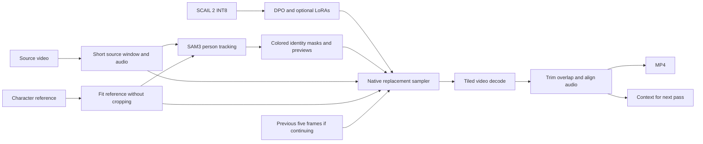

# Recast

Recast is a local dashboard for character replacement, with NVIDIA inference on a rented Vast GPU and drafts, references, media and Library on your computer. On this branch, Remotion uses the copied OpenJutsu Simple motion-transfer workflow and its recovered working preset.

```bash
bash scripts/studio.sh
```

Open **http://127.0.0.1:3000**. See [Studio setup and instance management](studio/README.md). Starting the app does not rent or resume a GPU. Keep `studio/data/` for private drafts/media and `.local/` for local connection/runtime state; neither belongs in Git.

For a new installation, open **GPU cloud → Set up Vast account**. Enter your own [Vast API key](https://cloud.vast.ai/manage-keys/) and choose **Create or reuse a Recast key**, or select an existing local private-key file. **Verify & save** checks your account without renting compute. The same controls are in **Settings → Connection → Account & SSH keys**. No Vast CLI installation or developer SSH key is required. [First-run setup and credential storage](docs/user-setup.md).

- **Imagen** edits a photo or extracted video frame with native Qwen Image 2.1 INT8/Turbo. The current body-only recipe transfers character appearance while retaining source clothing, accessories, pose and scene. Select one body view and one facial view from a saved character, or use the two-image route. [Recipe, comparisons and remaining limits](docs/imagen-consistency-20261029.md).
  New Imagen requests explicitly anchor head scale/direction and attached ears/hair to the source frame, with local pose cues and a saved geometry review. The tested update improves head direction and earring attachment; exact scale still needs review. [Head-layout comparison](docs/imagen-head-layout.md).
- **Image Edit** is a separate Qwen Image Edit 2511 module with one to three ordered reference images, a direct prompt, native 40-step or optional four-step Lightning sampling, aspect/size/seed controls and PNG/JPEG output. This is a GPU alternative to Kie’s image editor; identical quality or speed is not established. [Setup, storage and recovery](docs/image-edit-2511.md).
- **Characters** saves separate body/face sheets and selected views. Each run freezes its character revision and crop coordinates. [Character guide](docs/characters-and-imagen.md).
- **Clarity** is a separate, experimental video upscaler using FlashVSR+ Turbo. Upload a clip or choose a Library result, then create a 720p/1080p copy. Three optional weights total 7.02 GB; allow 25 GB extra disk for runtime and short-clip working space. Managed GPU quality/speed are not yet benchmarked. [Setup, storage and recovery](docs/clarity-upscaling.md).

- **Remotion** uses OpenJutsu Simple with the general MiniMax H3 INT8 model, six steps, DMAD strength 1 and 512px motion guidance. The imported preset is 480p with source-video scenery; an explicit option takes the scene and outfit from the character image instead. The native video is saved without the old automatic face-finishing passes. [Imported settings, dependencies, recovery and validation](docs/openjutsu-remotion.md).
- **Historical Viggle videos** retain their saved settings, graphs and recovery. The previous facial-consistency, later-frame and Imagen-boundary recipes are preserved for those runs; they are not added to a new OpenJutsu video.
- **Library** keeps photos/videos, favourites, trash, search, saved settings and before/after inspection. The local **Clip editor** trims and joins uploaded or Library clips, with a lossless master and playable MP4 preview.

GPU cloud searches RTX and Datacenter offers, checks exact rental asks and fees, manages instances and supports favourites. New offers require known ingress of at most **$0.005/GB**. Setup installs a blank pinned ComfyUI engine. Remotion, Imagen and Clarity share a bottom **Download [module]** action whenever selected files or tools are missing, with progress on the button and an expandable file list. Once prepared, the button returns to generation. Selection, refresh and generation never implicitly download models or resume compute. **Settings → Downloads** contains the full inventory and explicit **Download all models** action; optional files remain in Extras. [Unified downloads and recovery](docs/unified-module-downloads.md), [on-demand files](docs/model-downloads.md), [fast startup](docs/fast-startup.md).

OpenJutsu's selected seven-file preset totals 51.16 GB decimal, including three components shared with the existing catalog. Allow additional runtime, media and working space; GPU search calculates these reserves. Other module and adapter files remain optional. Existing paid jobs retain their recorded graphs and settings; SCAIL/Wan selection remains disabled for new Studio work.

Healthy slow setup continues with a yellow warning; actual failures show red messages and request a compute stop while retaining the disk. The optional five-minute idle pause waits for all renders, transfers and face processing to finish, then checks remote activity before stopping compute. Paused disks remain billed until destroyed. Keep the local app running for recovery, idle checks and notifications. [Alerts](docs/alerts.md).

The [2026-10-29 validation](docs/validation/later-frame-reference-20261029.md) records full Generate times and cost estimates, including the nine-second/704p combined test at 12m34s. Imagen no-op behavior improved in fifteen comparisons, but fine facial detail, exact gaze, printed details, hands and occlusions still need review. No universal photorealism, identity lock or sub-three-minute 704p target is claimed. Model/dependency terms recorded in the manifests must be reviewed separately before a hosted commercial service.

The instructions below preserve the original SCAIL ComfyUI/CLI workflow and its historical checks. They are not the current Remotion/Imagen model-download recipe. Existing SCAIL jobs and editable graphs remain available for recovery and inspection.

## Retained SCAIL workflow and CLI



The graph is arranged from left to right: inputs, tracking, models and LoRAs, reference/text conditioning, replacement, sampling, then export. Generation and scheduling share the same patched model. The two sampling presets change steps, CFG and the acceleration LoRA together.

| File | Purpose |
|---|---|
| `workflows/scail2_int8_masks.json` | Inspect the selected source person and reference masks before a render |
| `workflows/scail2_int8_swap.json` | Main editable ComfyUI workflow |
| `workflows/api/` | Matching API graphs for the batch tool and a future frontend |
| `custom_nodes/character_swap_helpers/` | Small local controls, geometry, LoRA and continuation helpers |
| `config/models.lock.json` | Exact file revisions, sizes and SHA256 hashes |
| `config/runtime.lock.json` | Pinned ComfyUI, video-node and PyTorch versions |
| `scripts/vast.py` | Local deployment, connection, backups and LoRA upload |
| `scripts/render_clip.py` | Optional continuation client for a longer continuous shot |

There are two installed node packs: this project's lightweight helpers and [VideoHelperSuite](https://github.com/Kosinkadink/ComfyUI-VideoHelperSuite). Person tracking and generation use native ComfyUI nodes. No ComfyUI Manager, paid API integration, separate pose estimator, face-swap model or upscaler is required.

Setup applies one recorded compatibility fix to the pinned VideoHelperSuite decoder: a video with no audio stream returns empty audio instead of failing during ComfyUI caching. Existing sound is retained, and corrupt media still raises an error. The patch hash is recorded in remote `state/runtime-patches.json`; `tests/check_silent_audio.py` checks all three cases against the actual decoder. No soundtrack is synthesized for a silent input.

## Choose a rental

Use an on-demand, single-GPU instance for the first setup. The target is:

| Resource | Starting configuration |
|---|---|
| GPU | RTX 3090 or 4090, 24 GB VRAM; a 5090 is optional |
| System RAM | Prefer 48–64 GB; the tested process reached about 32 GiB resident with relighting. 32 GB needs separate memory tuning and testing |
| Disk | 80 GB allocated, preferably SSD/NVMe |
| Driver | NVIDIA 580.65.06 or newer; offer must support CUDA 13 |
| Template | Vast recommended NVIDIA CUDA or PyTorch, Ubuntu, with SSH access |
| Reliability | Prefer a verified host, high reliability, and good CPU-to-GPU bandwidth |

This CUDA 13 package uses PyTorch 2.11.0 and torchvision 0.26.0. [NVIDIA documents the CUDA 13 driver requirements](https://docs.nvidia.com/deploy/cuda-compatibility/minor-version-compatibility.html). A suitable host driver is necessary even when the container has the right CUDA packages. An older container Python can be replaced automatically with an isolated Python 3.12 runtime.

Setup now installs the runtime **without model weights**. Download selected files explicitly with the module’s bottom action or through Settings → Downloads. The historical SCAIL five shared weights total **26.654 GB decimal**. Natural swap with DPO and relighting needs **29.739 GB**; Fast swap needs **29.846 GB**. Installing every SCAIL adapter would total **30.477 GB**, but unused features are never downloaded automatically. See [manual downloads](docs/model-downloads.md). Disk also contains the container environment, a Python environment, temporary frames, uploaded media and results. Additional models, LoRAs or upscalers consume extra space. Inspect the host's disk and download-bandwidth rates before renting; model downloads are billed by some Vast hosts.

Do not choose a huge all-in-one ComfyUI template for this package. It installs a separate, pinned ComfyUI into `/workspace/ComfyUI-character-swap` so it does not overwrite another application.

## First connection and setup

Run these commands on your Mac from this project directory. Python 3 and OpenSSH are sufficient for the connection helper. Local FFmpeg is only needed for assembling the optional batch output.

1. Print your public SSH key:

   ```bash
   python3 scripts/vast.py key
   ```

   It uses an existing key when available. If none exists it starts `ssh-keygen`, where you choose a passphrase. Add the displayed **public** key in Vast's account SSH Keys area **before** creating the instance. Keep the private key on your Mac. [Vast SSH guide](https://docs.vast.ai/guides/instances/connect/ssh)

2. Create the instance using the configuration above. Once it is running, copy the SSH command from its connection panel.

3. Save that command locally:

   ```bash
   python3 scripts/vast.py configure
   ```

   Paste the SSH command when prompted. An existing `-L` forwarding option in Vast's command is ignored because this helper creates the ComfyUI tunnel. No Vast API key is needed. If the private key is not in a standard SSH location, use `--identity` with its actual local file path.

4. Deploy and set up:

   ```bash
   python3 scripts/vast.py setup
   ```

   The command uploads only the setup files. On the GPU host it checks the driver, RAM and free disk; installs the pinned runtime without model weights; keeps sample media opt-in; copies the workflows into ComfyUI; starts the private server; and checks the live node schemas. It then opens your browser. Existing saved workflows and input files are kept on a repeated setup.

The browser address is **http://127.0.0.1:8188**. Traffic goes through SSH to a server listening only on the remote loopback interface. You do not need to expose port 8188 publicly or set up a cloud tunnel.

Setup transfers the runtime packages. This standalone CLI path installs the runtime only. Studio GPU cloud also starts a blank engine. Download only the files for the current settings from Remotion; all LoRAs stay optional. For direct ComfyUI CLI use, request the base bundle on the host with `.venv/bin/python scripts/download_models.py --model-dir models`. Requested downloads resume from partial files and verified weights are reused. Kernel compilation and model staging can also make the first generation slower than later runs. If SSH drops during setup, rerun `setup` after reconnecting.

If port 8188 is already used on your Mac, configure with `--local-port 8190`, then open the resulting address printed by the helper. The private remote port is 18189, separate from the Vast preset's ComfyUI service. If another application occupies that remote port, change `config/server.json` before deploying and reconfigure the local connection. When Vast's supervisor environment is available, this installation registers a private service with automatic restart. Bare CUDA images use an owned background process instead. Logs are saved in `state/comfyui.log`; process recovery checks the exact installation, port and input directory.

## Everyday use

After restarting the same Vast instance, reconnect with:

```bash
python3 scripts/vast.py open
```

It starts this ComfyUI if necessary, restores the SSH tunnel and opens the browser. It does not reinstall Python or download models again. ComfyUI continues running when the browser closes.

In ComfyUI, open the saved workflow named **Character Swap / 02 Character Swap INT8**. You can also drag `workflows/scail2_int8_swap.json` into the editor. The upstream demo source and reference are installed for an initial check; replace them with your own uploads.

The current instance also has **Character Swap / 03 Tested 3-second Relight**, using the exact inputs and settings from the GPU comparison. Its local editable copy is `outputs/first-gpu-test/tested-workflow.json`. The before/after comparison is `outputs/first-gpu-test/before-after.mp4` (original left, generated right).

1. Upload a short source video in **Upload source video** and the character image in **Upload character reference**.
2. Set **Shot settings** to the correct orientation. Start at 480 × 832 for portrait or 832 × 480 for landscape, 16 fps, 81 source frames. Choose 49 frames for a smaller first test. Dimensions must be multiples of 32. Inputs are fitted with padding instead of stretching faces or cropping the character.
3. Keep `skip_frames=0` and **Previous context** empty for a new shot.
4. In **Describe source person to track**, use a specific description when there are multiple people, such as a person's clothing. The reference prompt should identify the reference subject.
5. Inspect the masks. `object_indices=0` selects the first tracked person after the configured sorting. Keep one intended identity in both the source and reference mask. The separate **01 Check Masks** workflow runs the tracking stage without loading the video diffusion model.
6. Describe the replacement person's appearance, hair, clothing and scene in the positive prompt. The reference supplies the identity; the source supplies performance and environment.
7. Run the main graph. The final MP4 appears in the export node and in the remote `data/output/character_swap/` directory. A separate context record contains the last five decoded frames for continuation.

| Preset | Steps | CFG | Speed LoRA | Intended use |
|---|---:|---:|---:|---|
| `fast_6_steps` | 6 | 1 | 0.8 | Starting baseline and iteration |
| `undistilled_40_steps` | 40 | 5 | 0 | Comparison without the acceleration adapter |

The DPO adapter defaults to strength 1. More sampling steps do not guarantee a better result. Compare presets using the same input, resolution and seed. Keep the source and reference sharp enough that the face is identifiable; a tiny or blurred face cannot establish detailed identity.

For realism, inspect face identity during turns, hair boundaries, fingers, objects held in the hands, feet touching the ground, unchanged bystanders, background structure, and lighting throughout the clip. Do not judge only the first frame. A character sheet or better reference may improve a weak shot more than an unrelated LoRA.

## Continue a longer shot

The workflow keeps each model pass at 81 source frames or fewer. With 81-frame passes, later passes overlap the previous five frames and add 76 new frames. This controls memory and provides a continuity anchor. Hard cuts should start new shots with empty context.

For manual continuation in ComfyUI:

1. Read **Next context path and source end frame** in the editor, or the previous result's execution history.
2. Paste its relative `.safetensors` context path into **Previous context**.
3. Set `skip_frames` to that record's `source_end_frame - 5`.
4. Keep the same source, reference, dimensions, frame rate, prompt, adapters and seed. Queue the next pass.

The loader validates the context geometry, frame rate and source offset. The export removes the five duplicate frames and trims audio to match. A short final source window is padded only for the model's 4n+1 temporal grid, and the extra frames are discarded from the exported result.

For automatic continuation through the same ComfyUI API, keep your SSH tunnel open and run:

```bash
python3 scripts/render_clip.py
```

It prompts for your actual local source video, reference, duration and appearance prompt. Its command-line options also allow resolution, frame rate, source-person description and existing LoRAs. Use `--help` to see the options.

For a 30-second result at 16 fps, it requests 480 output frames using seven short passes. It uploads the media once, saves a run record before each job, carries lossless-frame context on the server, downloads each MP4, and assembles `final.mp4`. Final assembly uses the original audio track once rather than concatenating repeatedly encoded audio. It does not interpolate frames or upscale.

Runs are stored in local `outputs/batches/`. To resume, pass `--resume` with the actual run directory or its `run.json`. An in-progress job is awaited rather than submitted twice. If the instance restarted and lost that job, `--retry-missing-job` can resubmit only the unfinished segment after checking it is absent from the queue and history. Reconnect to the same instance with its stored inputs and contexts for a normal resume.

Longer generation can still drift. The five-frame anchor improves continuity; it does not establish perfect identity over arbitrary durations. Start with a short comparison before paying for a full 30-second pass.

## Add an existing LoRA

Upload a `.safetensors` LoRA with the helper's `push-lora` command and its actual local file path, or copy it into remote `/workspace/character-swap/models/loras/user/`. Refresh ComfyUI's model list, then select `user/filename.safetensors` in **Optional model-matched LoRA A** or **B**. `None` leaves that slot inactive.

The slots delegate to ComfyUI's native model-only LoRA loader. They add no content analysis. Choose an adapter trained for this architecture and check its effect on a short clip before stacking more. Reset continuation context when changing identity, model, LoRAs or prompts.

SCAIL-2 DPO and LightX2V are already in the main chain. The first GPU comparison added `wan2.1_SCAIL_2_relight_lora_bf16.safetensors` in slot A at strength 1. It reduced the bright outline and matched the scene lighting better on this particular shot. The adapter is pinned in `config/optional-models.lock.json` and is installed on the current instance. On a fresh instance, run the downloader with that manifest, then select it in slot A. The seven-file base installation leaves it optional. [SCAIL-2 relighting documentation](https://github.com/zai-org/SCAIL-2#relighting-lora)

On the GPU host, from `/workspace/character-swap`, the optional download command is:

```bash
.venv/bin/python scripts/download_models.py --manifest config/optional-models.lock.json
```

Select `wan2.1_SCAIL_2_relight_lora_bf16.safetensors` in slot A afterwards. It uses the same resumable, checksum-verified downloader as the base files.

Background replacement, upscaling, interpolation and other model families remain separate future additions so the initial installation stays small.

## Logs, backups and billing

```bash
python3 scripts/vast.py status
python3 scripts/vast.py logs
python3 scripts/vast.py doctor
python3 scripts/vast.py pull
```

`pull` downloads outputs, saved workflows and setup records into local `outputs/` and `backups/`. It excludes the large model weights. Generation embeds its prompt metadata in the export, and `state/installed-packages.txt` records the installed Python packages.

Closing the browser, closing the tunnel with `vast.py close`, or stopping only ComfyUI with `vast.py stop-server` does not stop GPU rental billing. Stop the instance in Vast when you finish. Container storage remains billable while stopped. Download important outputs and saved workflows before destroying an instance.

Keeping the same instance gives the fastest next session. Vast local volumes are tied to their host; moving to a different host can require downloading the models again. [Vast storage documentation](https://docs.vast.ai/guides/instances/storage/types)

## Troubleshooting

Studio restores a dropped managed SSH tunnel by checking the existing render. **Check & resume** never silently repeats a segment that disappeared after a server restart: it shows **Render missing segment again** and explains the extra compute cost. Completed segment receipts are saved locally before media transfer, so an interrupted download can be recovered without sampling that segment again. See [connection recovery](docs/connection-recovery.md) for the investigation and limits.

| Symptom | Action |
|---|---|
| SSH permission denied | Add the public key to the account before creating an instance, or use Vast's instance-specific key management; verify the private-key path |
| CUDA driver check fails | Select a host with CUDA 13 support and driver 580.65.06 or newer |
| Red or missing nodes | Run `setup` to install the pinned core and both node packs; refresh the browser afterwards |
| Models absent from dropdowns | Use Download [module] at the bottom of its settings; individual files are also in Settings → Downloads |
| Model download interrupted | Progress reconnects to the same rental; use Retry downloads after a terminal failure. Partial files resume and completed files are hash-verified |
| Wrong person is replaced | Fix the tracking text, selected object index and reference mask before changing the sampler |
| Face or clothes change | Improve the reference and prompt; use one continuous shot; compare adapters individually |
| Out of memory | Start with 49 frames at 480p-class resolution, remove optional adapters, and inspect RAM as well as VRAM |
| VAE decode runs out of memory | Reduce tiled decode's spatial size from 512 to 256 or temporal size from 32 to 16, keeping valid overlap |
| Continuation context error | Use the matching previous context, identical dimensions/fps, and `source_end_frame - 5`; clear context for a new shot |
| Audio drifts in a manually joined video | Use the batch tool's final assembly with the original audio track |
| Browser stops connecting after instance replacement | Copy the new instance's SSH command and run `configure` again |

The standard server uses PyTorch attention and leaves model offloading enabled. It does not force Comfy Kitchen attention, install SageAttention or xFormers, or preload all model weights into VRAM.

## Validation and upstream references

Local checks cover graph schemas and connections, ComfyUI's own prompt validation, optional-LoRA bypass, aspect-ratio preservation, padded tail trimming, continuation offsets, audio slices, download resume and checksum failures, and SSH-command parsing. CPU checks do not validate CUDA INT8 kernels or generated visual quality.

A live CPU API test also completed two bookkeeping/export passes with synthetic footage, carried the five-frame context, and assembled 94 unique output frames with aligned audio. Model nodes were disconnected from the executed outputs for this test. Browser layout was checked structurally for overlap; interactive GUI preview was unavailable in this session.

Run the standard-library tests with `python3 -m unittest discover -s tests -p 'test_tools.py' -v`. The `tests/validate_with_comfy.py` integration check uses an installed ComfyUI and CPU PyTorch; its help explains the required path. Its temporary filename fixtures validate schemas only and contain no model weights.

The workflow follows [ComfyUI's native SCAIL-2 implementation](https://docs.comfy.org/tutorials/video/zai/scail2), the [official INT8 template](https://github.com/Comfy-Org/workflow_templates/blob/main/templates/video_wan21_scail2_character_replacement_int8.json), and [Comfy-Org's model files](https://huggingface.co/Comfy-Org/SCAIL-2). Research snapshots are retained under `research/`.

ComfyUI and VideoHelperSuite have their own code licenses. SCAIL-2 is published under MIT, Wan support weights under their upstream terms, and SAM3.1 under its model license. Local operation and absence of added filters do not replace those licenses. Sources and exact model provenance are recorded in `config/models.lock.json`.
